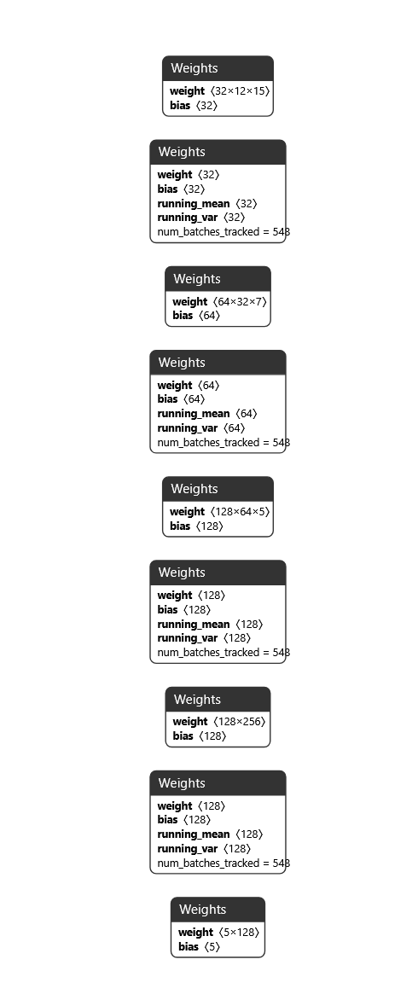
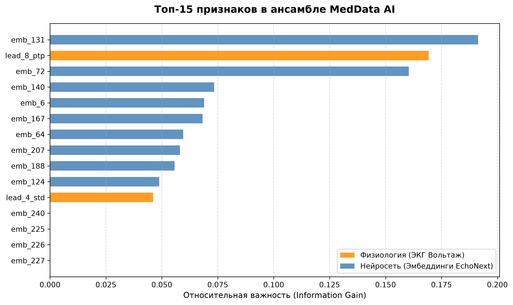
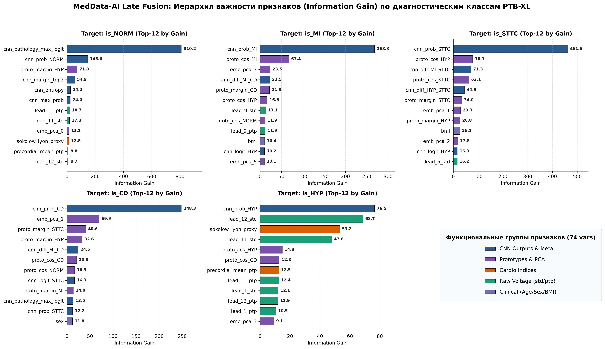
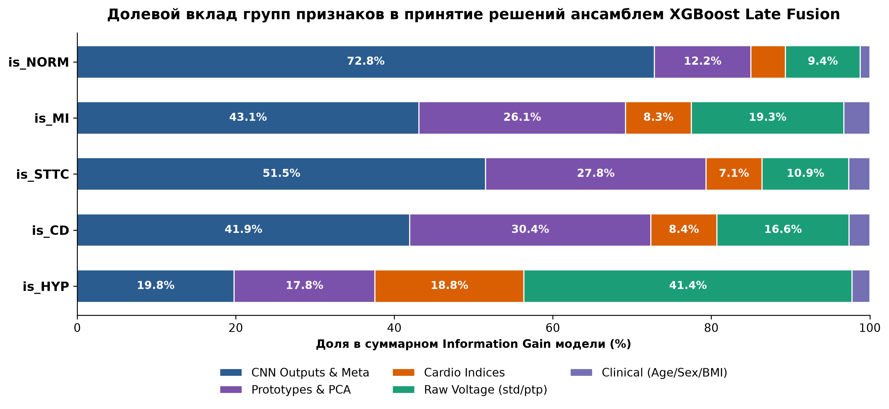

# MedData AI: Гибридная система анализа 12-канальной ЭКГ и клинических данных


**MedData AI** — это многомодульный конвейер цифровой обработки сигналов (ЦОС), глубокого обучения (`EchoNext-Mini V2`) и градиентного бустинга (`XGBoost`), разработанный для оценки сердечно-сосудистых рисков и выявления структурных патологий миокарда на базе датасета **PTB-XL** (21 799 записей ЭКГ).

---

## Оглавление
1. [Ключевая проблема и архитектурное решение (Hybrid Late Fusion)](#1-ключевая-проблема-и-архитектурное-решение-hybrid-late-fusion)
2. [Модуль 1. Цифровая предобработка сигнала (DSP Pipeline)](#2-модуль-1-цифровая-предобработка-сигнала-dsp-pipeline)
3. [Модуль 2. Архитектура и обучение нейросети EchoNext-Mini V2](#3-модуль-2-архитектура-и-обучение-нейросети-echonext-mini-v2)
4. [Результаты на изолированном тесте и доказательство гипотезы](#4-результаты-на-изолированном-тесте-и-доказательство-гипотезы)
5. [Модуль 3. Полномасштабный ансамбль XGBoost Late Fusion (74 признака)](#5-модуль-3-полномасштабный-ансамбль-xgboost-late-fusion-74-признака)
6. [Структура сформированных таблиц и файлов](#6-структура-сформированных-таблиц-и-файлов)
7. [Быстрый старт и воспроизведение](#7-быстрый-старт-и-воспроизведение)

---

## 1. Ключевая проблема и архитектурное решение (Hybrid Late Fusion)

При обучении стандартных сверточных нейросетей на сигналах ЭКГ применяется поотведенческая Z-нормализация (`μ = 0, σ = 1`). Она необходима для выравнивания масштаба каналов, но **полностью стирает информацию об истинной высоте зубцов в милливольтах**. В результате классические нейросети теряют способность диагностировать состояния, зависящие от абсолютного вольтажа — прежде всего **гипертрофию миокарда** (критерии Соколова-Лайона) и низковольтные состояния при сердечной недостаточности.

В **MedData AI** реализована двухпоточная гибридная схема:
1. **Морфологический поток (1D-CNN `EchoNext-Mini V2`):** принимает Z-нормализованные тензоры размерности `(2500, 12)`, анализирует исключительно *форму и ширину* волн P-QRS-T и извлекает **128 линейно независимых признаков** + **5 откалиброванных вероятностей** макроклассов.
2. **Физиологический и клинический поток:** **до** выполнения Z-нормализации извлекает **24 истинных вольтажных признака** (размах `ptp` и стандартное отклонение `std` в мВ для каждого из 12 отведений) и объединяет их с очищенными данными пациента (`age`, `sex`, `bmi`).

---

## 2. Модуль 1. Цифровая предобработка сигнала (DSP Pipeline)

Каждый 10-секундный сигнал ЭКГ из базы PTB-XL проходит трёхступенчатую обработку (`src/preprocess_dataset.py` и `src/module1_full_pipeline.py`):

### 2.1. Каскадная нуль-фазовая фильтрация (`Notch 50 Гц` + `Butterworth 0.5–40 Гц`)
Двунаправленная фильтрация через секции второго порядка (`scipy.signal.sosfiltfilt`) устраняет дыхательный дрейф изолинии (`< 0.5 Гц`), высокочастотный мышечный тремор (`> 40 Гц`) и полностью вырезает сетевую наводку `50 Гц`. Нулевой фазовый сдвиг (`0 рад`) гарантирует отсутствие временного смещения зубцов P, QRS и T.


* **А) Сигнал до фильтрации:** виден медленный дыхательный дрейф изолинии (`0.25 Гц`) и высокочастотное утолщение линии из-за сетевой помехи `50 Гц`.
* **Б) Сигнал после `sosfiltfilt`:** изолиния стабилизирована строго на уровне `0 мВ`, фазовый сдвиг равен `0 рад`.
* **В и Г) Спектры Фурье (FFT) до и после очистки:** паразитные пики на `0.25 Гц` и `50 Гц` полностью подавлены, сохранено полезное диагностическое окно `0.5–40 Гц`.

### 2.2. Полифазная передискретизация (`500 Гц → 250 Гц`)
Сжатие сигнала с `(5000, 12)` до `(2500, 12)` (`float32`) выполняется полифазным методом (`scipy.signal.resample_poly`) со встроенным антиалиасинговым FIR-фильтром, что исключает эффект Гиббса и предотвращает срезание острых верхушек R-зубцов.


* Абсолютная погрешность на пике высокочастотного зубца R составляет всего **Δ = 0.0044 мВ (1.16%)**, что ниже уровня аппаратной погрешности кардиографа.

### 2.3. Поотведенческая Z-нормализация и спасение вольтажа
Устраняет природный дисбаланс амплитуд между грудными отведениями и отведениями от конечностей (разница в размахе между `V2` и `aVL` достигает 7.8 раз), приводя каждый канал к `μ = 0.00, σ = 1.00` после предварительного сохранения реальных милливольтов в таблицу метаданных.


---

## 3. Модуль 2. Архитектура и обучение нейросети `EchoNext-Mini V2`

С опорой на базовую концепцию `EchoNext-Mini` была спроектирована и обучена модифицированная архитектура `EchoNextMiniV2` (`src/module2_corrected_train_and_extract.py`, веса сохранены в `models/echonext_mini_v2_weights.pth`, объём — **385 КБ**, **95 525 параметров**):

* **Расширение рецептивного поля (`dilation = 2, 4`):** использование дилатационных сверток во втором и третьем каскадах позволяет сети охватывать весь кардиоцикл целиком, фиксируя связь между комплексом QRS и сегментом ST-T.
* **Двойной глобальный пулинг (`AdaptiveAvgPool1d` + `AdaptiveMaxPool1d`):** конкатенация средней энергии сигнала и экстремумов зубцов (`128 + 128 = 256` каналов).
* **Нелинейный проекционный блок полного ранга (`Linear(256 → 128) + BatchNorm1d + ReLU`):** формирует 128 линейно независимых признаков (проверка через SVD подтвердила полный математический ранг матрицы **128 из 128** и **0 «мёртвых» нейронов** на всех 21 799 записях).



### Защита от утечки данных (Data Leakage Prevention)
Обучение и валидация выполнены строго по официальным стратифицированным фолдам `strat_fold` базы PTB-XL с разделением по уникальному `patient_id`:
* **Train (Фолды 1–8):** `17 418` ЭКГ — обучение модели (4 эпохи, 548 шагов обновления весов батчами по 128).
* **Validation (Фолд 9):** `2 183` ЭКГ — контроль сходимости и отбор лучших весов.
* **Test (Фолд 10):** `2 198` ЭКГ — полностью изолированный экзаменационный набор.

---

## 4. Результаты на изолированном тесте и доказательство гипотезы

Оценка качества обученной нейросети `EchoNext-Mini V2` (без использования табличного вольтажа и антропометрии) по 5 диагностическим макроклассам PTB-XL:

| Код макрокласса | Медицинское описание | Доля в базе | Train (Фолды 1–8) | Val (Фолд 9) | Test (Фолд 10) |
| :--- | :--- | :---: | :---: | :---: | :---: |
| **`is_NORM`** | Нормальная ЭКГ | 43.64% | 0.9625 | 0.9340 | **0.9338** |
| **`is_STTC`** | Ишемические изменения ST и зубца T | 24.01% | 0.9420 | 0.9219 | **0.9192** |
| **`is_CD`** | Нарушения проводимости и блокады | 22.47% | 0.9403 | 0.9104 | **0.8977** |
| **`is_MI`** | Инфаркт миокарда | 25.09% | 0.9337 | 0.9034 | **0.8922** |
| **`is_HYP`** | Гипертрофия миокарда | 12.15% | 0.8739 | 0.8112 | **0.8126** |
| **`Macro ROC-AUC`** | **Среднее по всем 5 макроклассам** | — | **0.9305** | **0.8962** | **0.8911** |

### Главный научный вывод этапа
1. На патологиях, определяемых **формой волны и шириной комплексов** (`NORM`, `STTC`, `CD`, `MI`), легковесная нейросеть достигает высокой точности (**ROC-AUC 0.892–0.934** на изолированном 10-м фолде).
2. На классе **гипертрофии миокарда (`is_HYP`)** точность чистой нейросети ожидаемо снижается до **0.8126**, так как главный диагностический критерий гипертрофии — абсолютное увеличение вольтажа зубцов R и S в милливольтах — стирается при Z-нормализации.
3. Это математически доказывает необходимость второго потока **MedData AI**: передачи сохранённых вольтажных признаков (`lead_1_ptp`–`lead_12_ptp`) и клинических данных (`age`, `sex`, `bmi`) в финальный ансамбль `XGBoost`.

> *Отладка слияния признаков на демо-выборке (N=10):* Прототипирование ансамбля подтвердило, что градиентный бустинг включает сохранённые амплитудные признаки (`lead_8_ptp`, `lead_4_std`) в число главных предикторов (по `Information Gain`) наравне с эмбеддингами нейросети:



---

## 5. Модуль 3. Полномасштабный ансамбль `XGBoost Late Fusion` (74 признака)

В третьем модуле выполнено масштабирование гибридного слияния на все **21 799 записей PTB-XL**. Вместо прямой подачи всех 128 сырых эмбеддингов (при которой высокоразмерный вектор нейросети подавляет табличные признаки вольтажа при построении деревьев), было сконструировано **74 специализированных признака**, разделённых на 5 функциональных групп:

### 5.1. Структура признакового пространства (74 переменные)

| Группа признаков | Кол-во | Переменные в модели | Назначение в ансамбле Late Fusion |
| :--- | :---: | :--- | :--- |
| **1. Выходы и мета-признаки CNN** | 17 | `cnn_prob_*` (5), `cnn_logit_*` (5), `cnn_entropy`, `cnn_margin_top2`, `cnn_max_prob`, `cnn_diff_MI_STTC`, `cnn_diff_MI_CD`, `cnn_diff_HYP_STTC`, `cnn_pathology_max_logit` | Оценка базовой морфологической вероятности, фильтрация нормы (`cnn_pathology_max_logit`) и разрешение конфликтов между смежными патологиями (`MI` vs `CD`, `HYP` vs `STTC`). |
| **2. Прототипы и PCA-эмбеддинги** | 18 | `proto_cos_*` (5), `proto_margin_*` (5), `emb_pca_0` ... `emb_pca_7` (8) | Геометрическое позиционирование записи в 128-мерном пространстве `EchoNext-Mini V2`: косинусное сходство и отступы до эталонных центров классов + 8 главных компонент PCA (обученных строго на фолдах 1–8). |
| **3. Сырой вольтаж (12 отведений)** | 24 | `lead_1_std`, `lead_1_ptp` ... `lead_12_std`, `lead_12_ptp` | Восстановление истинной амплитуды зубцов в милливольтах (размах Peak-to-Peak и СКО), стертой при Z-нормализации. |
| **4. Кардиологические индексы** | 12 | `sokolow_lyon_proxy`, `cornell_proxy`, `cornell_sex_adj`, `precordial_mean_ptp`, `limb_mean_ptp`, `prec_to_limb_ratio`, `lateral_to_inferior_ratio`, `anterior_to_inferior_ratio`, `bmi_voltage_index`, `age_voltage_ratio`, `ecg_crest_factor`, `v6_to_v5_ratio` | Доменно-специфичные нелинейные комбинации вольтажа и антропометрии для прямой детекции гипертрофии левого желудочка (`is_HYP`) и оценки электрической оси сердца. |
| **5. Клинический профиль** | 3 | `age`, `sex`, `bmi` | Демографическая стратификация и учёт ослабления потенциалов миокарда жировой тканью. |

### 5.2. Результаты обучения и прирост качества на изолированном тесте (Фолд 10)
Для каждого из 5 макроклассов обучена отдельная модель `XGBoost` (`models/xgb_late_fusion_is_*.json`) с жёсткой L2-регуляризацией (`l2 = 8.0–15.0`), ограничением глубины деревьев (`depth = 2–4`) и контролем ранней остановки (`early_stopping_rounds = 60`) на 9-м валидационном фолде по метрике **PR-AUC**:

* **Итоговый `Macro ROC-AUC` на изолированном 10-м фолде (2 198 пациентов):** вырос с **`0.8911`** (чистая нейросеть `EchoNext-Mini V2`) до **`0.9121`** (**`+2.10%`**).
* **Итоговый `Macro PR-AUC` на изолированном 10-м фолде:** вырос с **`0.7416`** до **`0.7870`** (**`+4.54%`**).
* **Прорыв на целевом классе гипертрофии миокарда (`is_HYP`):**
  * **ROC-AUC** на 10-м фолде вырос с **`0.8126`** до **`0.8837`** (**`+0.0711` / `+7.11%`**).
  * **PR-AUC** (главная метрика для несбалансированного класса, составляющего 12.15% выборки) вырос с **`0.4584`** до **`0.6211`** (**`+0.1627` / `+16.27%`**).
* **Устойчивость к переобучению (Validation vs Test):** на 10-м тестовом фолде `is_NORM` достиг **`0.9412` ROC-AUC** (против `0.9338` у чистой CNN и `0.9436` на Val), а `is_STTC` — **`0.9267` ROC-AUC** (против `0.9192` у чистой CNN и `0.9276` на Val). Лучшие валидационные скоры PR-AUC составили: `0.9207` для `is_NORM` (639 деревьев), `0.8220` для `is_CD` (534 дерева), `0.8096` для `is_MI` (905 деревьев) и `0.6488` для `is_HYP` (1081 дерево).

### 5.3. Иерархия важности признаков и долевой вклад модальностей
Анализ суммарного информационного выигрыша (`Information Gain`) по всем деревьям обученных моделей демонстрирует, как ансамбль адаптирует баланс между нейросетевыми и биофизическими признаками в зависимости от диагноза:

| Класс | Топ-5 признаков по Information Gain | Доля CNN & Meta | Доля Prototypes & PCA | Доля Cardio, Voltage & Clinical |
| :--- | :--- | :---: | :---: | :---: |
| **`is_NORM`** | `cnn_pathology_max_logit`, `cnn_prob_NORM`, `proto_margin_HYP`, `cnn_margin_top2`, `cnn_entropy` | 72.8% | 12.2% | **15.0%** |
| **`is_MI`** | `cnn_prob_MI`, `proto_cos_MI`, `emb_pca_3`, `cnn_diff_MI_CD`, `proto_margin_CD` | 43.1% | 26.1% | **30.8%** |
| **`is_STTC`** | `cnn_prob_STTC`, `proto_cos_HYP`, `cnn_diff_MI_STTC`, `proto_cos_STTC`, `cnn_diff_HYP_STTC` | 51.5% | 27.8% | **20.7%** |
| **`is_CD`** | `cnn_prob_CD`, `emb_pca_1`, `proto_margin_STTC`, `proto_margin_HYP`, `cnn_diff_MI_CD` | 41.9% | 30.4% | **27.6%** |
| **`is_HYP`** | `cnn_prob_HYP`, `lead_12_std`, `sokolow_lyon_proxy`, `lead_11_std`, `proto_cos_HYP` | 19.8% | 17.8% | **62.4%** |



* **Детальная иерархия признаков (`figures/fig4_multiclass_feature_importance.png`):**
  * **В классе `is_HYP`** сразу за базовой вероятностью `cnn_prob_HYP` (`76.5`) с огромным весом идут реальные милливольтовые характеристики левых грудных отведений V6 (`lead_12_std = 68.7`), суррогатный индекс Соколова-Лайона (`sokolow_lyon_proxy = 53.2`), вольтаж отведения V5 (`lead_11_std = 47.8`), средний размах грудных отведений (`precordial_mean_ptp = 12.5`) и амплитуда I стандартного отведения (`lead_1_std = 12.1`, `lead_1_ptp = 10.5`). Присутствие в топе косинусного сходства с центром блокад (`proto_cos_CD = 12.8`) позволяет модели отсекать ложноположительные срабатывания по вольтажу при блокаде левой ножки пучка Гиса.
  * **В классах `is_MI` и `is_CD`** ключевую роль играют прототипы и главные компоненты эмбеддингов (`proto_cos_MI = 67.4`, `emb_pca_3 = 23.5` в `is_MI`; `emb_pca_1 = 69.9`, `proto_margin_STTC = 40.8` в `is_CD`), а также дифференциальная разница логитов `cnn_diff_MI_CD`, разделяющая инфарктные зубцы Q и комплексы QS при блокадах.
  * **В классе `is_NORM`** признак `cnn_pathology_max_logit` (`810.2`) более чем в 5.5 раз опережает `cnn_prob_NORM` (`146.6`), работая как строгий фильтр исключения любой патологии.



* **Долевой баланс модальностей (`figures/fig5_modality_contribution_by_class.png`):** наглядно подтверждает инверсию модальностей в классе гипертрофии миокарда (`is_HYP`), где выходы нейросети дают лишь **19.8%** суммарного информационного выигрыша, а **62.4%** всей разделяющей способности обеспечивают спасённый физический вольтаж (**41.4%**), кардиологические индексы (**18.8%**) и клинические данные.

---

## 6. Структура сформированных таблиц и файлов

В папке `data_samples/` представлены образцы сгенерированных артефактов для проверки структуры данных:

### 1. Бинарные тензоры ЭКГ: `ecg_1.npy`
* **Формат и размерность:** массив NumPy, тип `float32 (<f4)`, матрица `(2500, 12)` (10 секунд по 250 Гц × 12 отведений).
* **Математический контроль:** среднее каждого канала строго `0.000000`, стандартное отклонение `1.000000`, пропусков `NaN / Inf` — `0`.

### 2. Мастер-таблица клиники и вольтажа: `ptbxl_clinical_and_voltage.csv` (`21 799 × 37`)
Превью первых 100 строк доступно в `data_samples/head_100_clinical_and_voltage.csv`. Содержит очищенные демографические данные (возрастной ценз HIPAA `300` приведён к `90.0` годам, рассчитан индекс массы тела `bmi`), метки `strat_fold`, 5 целевых макроклассов и 24 спасённых признака вольтажа:

| ecg_id | patient_id | strat_fold | age | sex | bmi | is_NORM | is_MI | is_HYP | lead_2_ptp (мВ) | lead_8_ptp (мВ) |
| :---: | :---: | :---: | :---: | :---: | :---: | :---: | :---: | :---: | :---: | :---: |
| 1 | 15709 | 3 | 56.0 | 1 | NaN | 1 | 0 | 0 | 0.5201 | 1.7951 |
| 2 | 13243 | 2 | 19.0 | 0 | NaN | 1 | 0 | 0 | 1.6693 | 4.0108 |
| 3 | 20372 | 5 | 37.0 | 1 | NaN | 1 | 0 | 0 | 0.8192 | 1.5005 |

### 3. Таблица нейросетевых признаков: `echonext_v2_embeddings.csv` (`21 799 × 134`)
Превью первых 100 строк доступно в `data_samples/head_100_echonext_v2_embeddings.csv`. Содержит 5 вероятностей макроклассов (`cnn_prob_*`) и 128 полноранговых эмбеддингов (`emb_0` ... `emb_127`):

| ecg_id | cnn_prob_NORM | cnn_prob_MI | cnn_prob_STTC | cnn_prob_CD | cnn_prob_HYP | emb_0 | emb_1 |
| :---: | :---: | :---: | :---: | :---: | :---: | :---: | :---: |
| 1 | 0.9955 | 0.0004 | 0.0004 | 0.0000 | 0.0003 | 0.0000 | 1.6155 |
| 2 | 0.9758 | 0.0039 | 0.0014 | 0.0008 | 0.0032 | 0.0000 | 1.4490 |
| 3 | 0.9870 | 0.0005 | 0.0045 | 0.0003 | 0.0013 | 0.0000 | 1.2668 |

### 4. Сохранённые модели в папке `models/`
* `models/echonext_mini_v2_weights.pth` — веса нейросети `EchoNext-Mini V2` (`385 КБ`).
* `models/xgb_late_fusion_is_NORM.json`, `xgb_late_fusion_is_MI.json`, `xgb_late_fusion_is_STTC.json`, `xgb_late_fusion_is_CD.json`, `xgb_late_fusion_is_HYP.json` — 5 обученных моделей ансамбля `XGBoost Late Fusion`.

---

## 7. Быстрый старт и воспроизведение

```bash
# 1. Клонирование репозитория и установка зависимостей
git clone [https://github.com/37Skomorokh73/MedData-AI.git](https://github.com/37Skomorokh73/MedData-AI.git)
cd MedData-AI
pip install -r requirements.txt

# 2. Генерация контрольных графиков цифровой предобработки (Модуль 1)
python src/demo_1_filtering_fft.py
python src/demo_2_resampling_qrs.py
python src/demo_3_normalization_leads.py

# 3. Полная обработка архива PTB-XL (21 799 ЭКГ) и сборка клинико-вольтажной таблицы
python src/module1_full_pipeline.py
python src/patch_clinical_table.py

# 4. Обучение EchoNext-Mini V2 (Фолды 1–8) и пакетное извлечение эмбеддингов (Модуль 2)
python src/module2_corrected_train_and_extract.py
